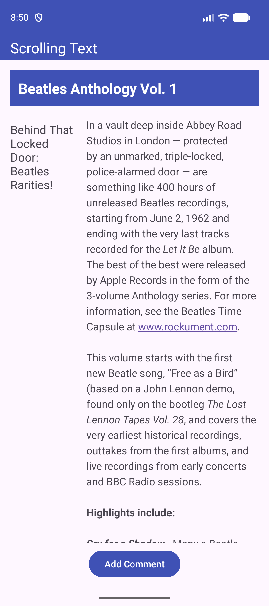
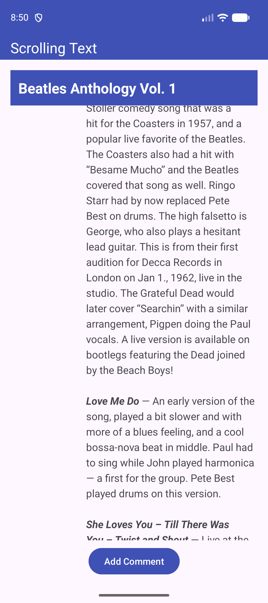
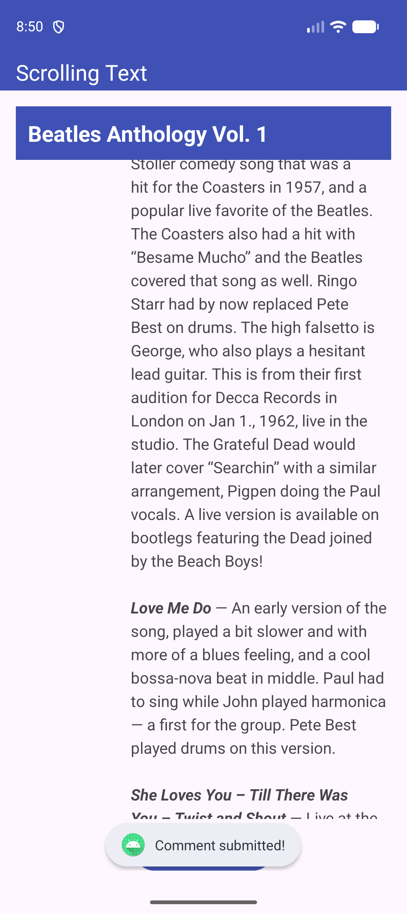

# ScrollingText

Aplikacija, ki daljše besedilo članka prikaže v dveh stolpcih znotraj drsnega pogleda, v Android Studiu

## Funkcionalnosti

- **MaterialToolbar** z modrim ozadjem in belim naslovom »Scrolling Text«
- **TextView** z naslovom »Beatles Anthology Vol. 1« na modrem ozadju, ki je izven drsnega pogleda in ostane na mestu, ko se besedilo premika
- **ScrollView**, ki vsebuje en sam **LinearLayout** z vodoravno usmerjenostjo, zato se celotno besedilo članka navpično drsi
- **TextView** s podnaslovom v levem stolpcu, širokem 100dp, da se podnaslov prelomi v več vrstic
- **TextView** z besedilom članka v desnem, širšem stolpcu, z imeni pesmi v krepki in poševni pisavi ter klikljivo povezavo www.rockument.com
- **Button** »Add Comment« na sredini spodaj, ki ob kliku prikaže Toast sporočilo »Comment submitted!«
- Vsa besedila so v datoteki `strings.xml`

## Posnetki zaslona

  
  &nbsp;&nbsp;&nbsp;
  
  &nbsp;&nbsp;&nbsp;
  

